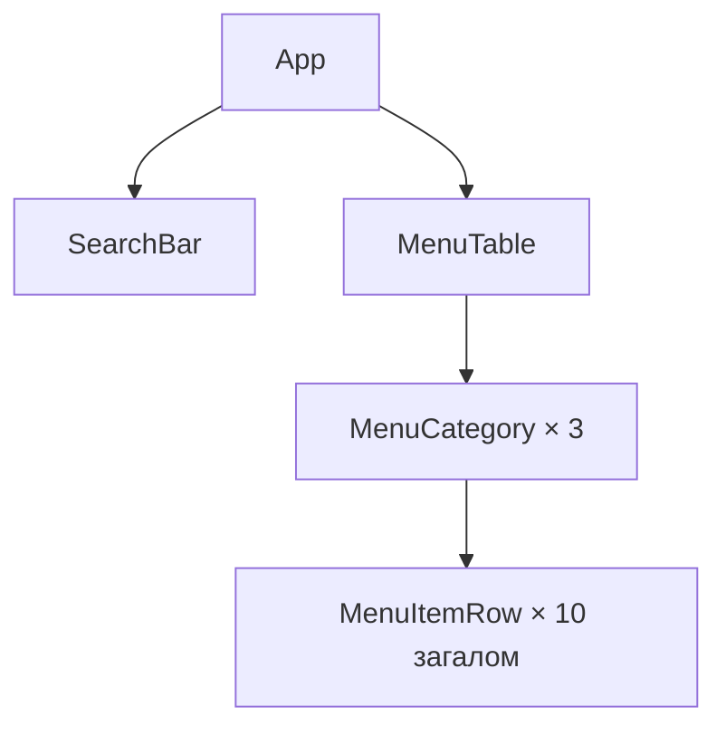

# ЛР-3. Рефакторинг за деревом компонентів

Проєкт лабораторної роботи № 3 курсу «Розробка вебзастосунків на
React»: сторінка «Меню кав'ярні». Інструкція:
https://denysmatsevych.github.io/web-development-2026/react/labs/lab-3/

Застосунок розкладено на чотири компоненти в `src/components/` зі збереженням
початкової розмітки й поведінки. Дані меню лежать у `src/data.js`, стилі —
у `src/index.css`. Пошук і прапорець залишаються статичними: `useState`
та обробники подій належать до наступної лабораторної роботи.

## Команди

`npm install` виконуйте в корені репозиторію `react-labs`, решту — у теці
`lab-3/`:

- `npm run dev`: dev-сервер на http://localhost:5173
- `npm run lint`: ESLint
- `npm run format:check`: перевірка форматування Prettier
- `npm run build`: production-збірка в `dist/`

## Ієрархія компонентів

Дерево компонентів після рефакторингу (GitHub показує блок як діаграму):

## Стан

Для кожного рядка таблиці дайте відповідь на три питання з кроку 3 Thinking in
React (§4.7):

1. Чи залишаються ці дані незмінними з часом? Якщо так, це не стан.
2. Чи передаються вони від батьківського компонента через пропси? Якщо так, це
   не стан.
3. Чи можна обчислити їх на основі наявного стану чи пропсів? Якщо так, це
   точно не стан.

| Дані                                           | Стан? | Чому                                                                                                    |
| ---------------------------------------------- | ----- | ------------------------------------------------------------------------------------------------------- |
| меню: категорії й позиції (`menu`)             | ні    | Сталі дані з `data.js`, які App передає вниз через пропси.                                              |
| текст у полі пошуку                            | так   | Користувач змінює його; з інших даних цей текст обчислити не можна.                                     |
| значення прапорця «Лише в наявності»           | так   | Окремий вибір користувача, що змінюється з часом.                                                       |
| позиції, що залишаться після фільтрування      | ні    | Обчислюються з `menu`, тексту пошуку й значення прапорця.                                               |
| кількість позицій у заголовку категорії, «(4)» | ні    | Обчислюється як довжина масиву позицій категорії; після фільтрування — довжина відфільтрованого масиву. |

Стан житиме в компоненті: **App**, бо це найближчий спільний батьківський
компонент `SearchBar` і `MenuTable`. `SearchBar` відображатиме текст пошуку
та значення прапорця, а `MenuTable` використовуватиме їх для фільтрування.
Майбутні значення стану — `filterText` і `inStockOnly`; у цій роботі вони
лише визначені в документації, а не реалізовані в коді.

`MenuItemRow` безпосередньо рендерить `MenuCategory`. Усього є три категорії:
«Кава» — 4 рядки, «Чай» — 3, «Десерти» — 3; разом 10 `MenuItemRow`.
Ключі категорій — `coffee`, `tea`, `desserts`, позицій — `item.id` від 1 до 10.
`key` стоїть на компоненті всередині відповідного `map`.

## Публікація

- GitHub: https://github.com/Byebyeskiy/react-labs/tree/main/lab-3
- Vercel: адресу потрібно додати після фактичного деплою.
- Налаштування Vercel: назва `react-lab-3`, Root Directory `lab-3`,
  Framework Preset `Vite`, Output Directory `dist`.

## Використання AI

AI-агент виконав винесення компонентів, підготував діаграму й таблицю стану
та запустив перевірки. Перед захистом потрібно самостійно розібрати
передавання пропсів, розміщення `key` і вибір `App` як власника майбутнього стану.

## Висновок

Монолітний `App` розділено на `SearchBar`, `MenuTable`, `MenuCategory`
і `MenuItemRow`. Дані передаються згори вниз через пропси. Основна увага
під час рефакторингу — збереження розмітки, перенесення імпортів і правильні
ключі списків. Визначено мінімальний майбутній стан: текст пошуку та прапорець.
